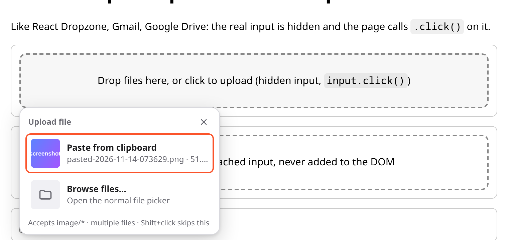

# Paste to Upload

A Chromium extension (built for **Brave**, works in any Chromium-based browser) that lets you **upload a file straight from your clipboard**.

Whenever a site is about to open the file picker, you get a small popover instead:



- **Paste from clipboard** (or just press <kbd>Ctrl</kbd>+<kbd>V</kbd>): the clipboard contents become the uploaded file, as if you had picked it in the file dialog. Screenshots and copied images are named like `pasted-2026-11-14-073629.png`.
- **Browse files…** opens the normal file picker.
- Hold <kbd>Shift</kbd> while clicking an upload button to skip the popover and go straight to the normal picker.

It works with plain `<input type="file">` fields and with the hidden inputs that most modern sites open from script (drag-and-drop zones, React Dropzone, Gmail, Google Drive, GitHub, …).

## Install (Brave)

**Not a developer?** Download the zip from the [latest release](https://github.com/Edgarcillo2k/chromium-upload-clipboard-resource/releases/latest) and follow [INSTALL.md](INSTALL.md). No tools needed.

### From source

You need [Node.js](https://nodejs.org/) 22.18+ (24 recommended) and [pnpm](https://pnpm.io/installation).

```sh
git clone https://github.com/Edgarcillo2k/chromium-upload-clipboard-resource.git
cd chromium-upload-clipboard-resource
pnpm install
pnpm build
```

Then load the build output into Brave:

1. Open `brave://extensions`.
2. Turn on **Developer mode** (top right).
3. Click **Load unpacked** and select the **`dist/`** folder of this repo.
4. Reload any tabs that were already open: the extension only runs on pages loaded after it was installed.

The same steps work in Chrome/Chromium (`chrome://extensions`), Edge (`edge://extensions`), Vivaldi, Opera, and so on.

To update after pulling changes, run `pnpm build` again and click the ↻ reload button on the extension's card in `brave://extensions`.

## Usage

1. Copy something: take a screenshot to the clipboard, use "Copy image" on a picture, or copy some text.
2. On any site, click its upload button / "Choose file" / "Attach".
3. In the popover, press <kbd>Ctrl</kbd>+<kbd>V</kbd>, or click **Paste from clipboard**.

The file goes into the page's upload field and the site reacts as if you'd picked it from disk: previews, auto-upload, form submission all work.

| What's on the clipboard | What gets uploaded |
| --- | --- |
| Screenshot / copied image | The image, as `pasted-YYYY-MM-DD-HHmmss.png` |
| Text | A `pasted-….txt` file (can be turned off in settings) |
| A file copied in the file manager | Usually not possible: on Linux the browser only receives the file's *path*, not its contents. The popover tells you to use **Browse files…** instead. |

Other details:

- **Ctrl+V vs. the Paste button.** <kbd>Ctrl</kbd>+<kbd>V</kbd> never needs a permission. Clicking the **Paste from clipboard** button uses the async clipboard API, so the first time on each site Brave asks whether the site may read your clipboard. If you allow it, the popover also shows a **preview** of the clipboard image when it opens.
- **File type checks.** If the upload field only accepts some types (`accept="image/*"`, `.pdf`, …) and the clipboard doesn't match, you get a warning with an *Upload anyway* option. If the field only accepts JPEG or WebP and you paste a PNG screenshot, it's converted automatically.
- **Multiple files.** On a visible `<input multiple>`, each paste adds to the files already selected. Hidden drop-zone inputs behave like the normal picker (they replace), so sites don't upload the same file twice.
- **Close the popover** with <kbd>Esc</kbd>, the ✕, or by clicking anywhere else. The site sees this the same way as you cancelling the normal file dialog.
- **Keyboard:** <kbd>↑</kbd>/<kbd>↓</kbd> or <kbd>Tab</kbd> move between the two options, <kbd>Enter</kbd> picks one.

## Settings

Click the extension's toolbar icon (pin it from the puzzle-piece menu), or go to `brave://extensions` → Paste to Upload → **Details** → **Extension options**.

- **Enabled**: master switch.
- **Sites**: either *run everywhere except* the listed sites (deny list, the default), or *run only on* the listed sites (allow list). One hostname per line; `example.com` also covers `www.example.com`, `drive.example.com`, and so on. You can paste full URLs and they're trimmed down to the hostname. The list also applies to upload widgets embedded in iframes on a listed site.
- **Skip the popover**: which key (<kbd>Shift</kbd>, <kbd>Alt</kbd>, <kbd>Ctrl</kbd>, or none) opens the normal picker directly when held while clicking.
- **Turn copied text into a .txt file**: on or off.

Settings sync through your browser profile (`chrome.storage.sync`) and apply right away.

## How it works

```
 page (MAIN world)                                   extension (ISOLATED world)
 ───────────────────────────────────────            ─────────────────────────────────
 src/main-world.ts                                   src/content/index.ts
  • capture-phase click listener on window            • reads settings, sends config
    (composedPath → finds inputs in shadow DOM)        • draws the popover in a closed
  • patches HTMLElement.prototype.click and              shadow root, in the top layer
    HTMLInputElement.prototype.showPicker            • Ctrl+V → paste event → File
  • stops the native picker ── "open" ─────────────▶  • button → navigator.clipboard.read()
                                                      • checks `accept`, converts images
  • DataTransfer → input.files, ◀── "insert" File ──
    fires input + change events
  • "Browse" → original click() ◀── "browse" ───────
```

- **Two ways a picker opens, two hooks.** A visible input the user clicks (including via a `<label>`) is caught by a capture-phase `click` listener that calls `preventDefault()`. A hidden or even detached input that the page opens from script is caught by patching `click()` and `showPicker()` on the prototypes. That requires a content script in the page's own JS world (`"world": "MAIN"`) at `document_start`, before page scripts run.
- **Two worlds talking.** The MAIN-world script can't use extension APIs and the isolated script can't touch the page's JS objects, so they exchange messages with `window.postMessage`, which also structured-clones `File` objects across. The isolated script draws the UI and reads the clipboard. The MAIN-world script owns the input and fills it, so React/Vue/Angular see a normal bubbling `change` event.
- **Opening the real picker.** **Browse files…** is a fresh user click, so the MAIN-world script calls the original, unpatched `click()` that it saved at startup, with a flag so it doesn't intercept itself.
- **Safety nets.** It only intercepts when the page has a real user activation (no popover for pickers the browser would block anyway). If the isolated script doesn't confirm within 500 ms (for example the extension was reloaded under an open tab), the normal picker opens instead.
- **Can't be broken by page CSS or CSP.** The popover is a closed shadow root with all styles inline, shown in the top layer via the Popover API (above modal dialogs). Content scripts aren't subject to the page's CSP.

Permissions: `storage` (settings) and `clipboardRead`. The extension makes no network requests.

## Limitations

- Drop zones with **no file input at all** (only a `drop` listener) aren't intercepted. Clicking them doesn't open a picker either, so there's nothing to catch.
- Inputs inside **closed** shadow roots that the user clicks directly can't be seen. Programmatic `click()` on them is still caught.
- Inside a very small iframe the popover is clipped to the iframe.
- **Copied files** from a file manager can't be pasted (see above). When the browser does receive actual file data in the paste, it's used as is.

## Development

```sh
pnpm install
pnpm dev          # rebuild dist/ on every change (then ↻ the extension)
pnpm build        # typecheck + production build into dist/
pnpm typecheck
pnpm serve:test   # serve the manual test pages at http://127.0.0.1:5179/
pnpm package      # build + release/paste-to-upload-v<version>.zip (manifest.json at the zip root)
```

Project layout:

```
src/manifest.json       MV3 manifest (version is taken from package.json at build time)
src/main-world.ts       MAIN-world hooks + DataTransfer injection
src/content/            isolated content script: popover UI, clipboard, accept handling
src/options/            options page
src/shared/             message protocol and settings shared by all parts
src/background.ts       toolbar icon → options page
scripts/build.ts        Vite build (each content script as its own IIFE bundle)
test/pages/             manual/e2e test pages
assets/icon.svg         icon source (pnpm icons → public/icons/*.png, needs rsvg-convert)
```

Content scripts are built with Vite's library mode as self-contained IIFE files (content scripts can't be ES modules, and the MAIN-world script must run synchronously at `document_start`). The options page is a normal Vite page.

### Tests

`test/pages/plain.html` (visible inputs: `accept`, `multiple`, `<label for>`, form) and `test/pages/dropzone.html` (hidden input + `.click()`, detached input, `showPicker()`, opacity-0 overlay, open shadow DOM, modal `<dialog>`) work for manual testing: `pnpm serve:test`, then open them in Brave with the extension loaded.

The end-to-end suite loads `dist/` into a real Chromium, runs every scenario on those pages through the real system clipboard and keyboard, and checks the page's `change` events:

```sh
pnpm exec playwright-core install chromium   # once
pnpm test                                    # build + e2e
CHROME_PATH=/usr/bin/brave pnpm test:e2e     # against another Chromium-based browser
ONLY=dropzone HEADED=1 pnpm test:e2e         # a subset, with a visible window
EXT_DIR=path/to/unzipped pnpm test:e2e       # test an unzipped release instead of dist/
```

### Releasing

1. Bump `version` in `package.json` (the manifest takes it from there).
2. `pnpm test && pnpm package`
3. Commit, then `gh release create v<version> release/paste-to-upload-v<version>.zip --title "v<version>" --notes "…"`
